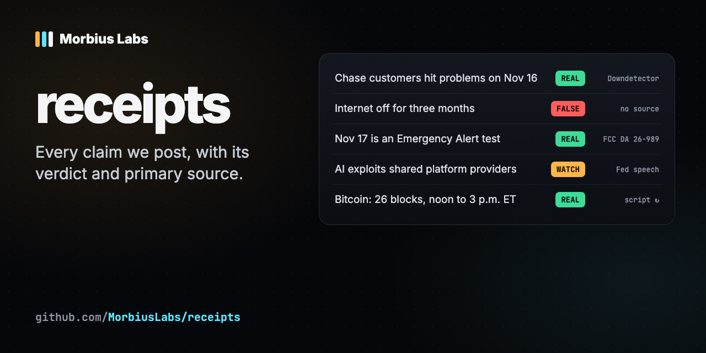

# receipts



Every claim we post, with its source.

[@morbius_labs](https://x.com/morbius_labs) covers the stories where AI and money meet: banks, crypto, stablecoins, payments. This repo is the paper trail. Each check, on X or on [morbiuslabs.org](https://morbiuslabs.org), gets a page that lists every factual claim, a verdict and the primary source behind it. Where a number comes from public data, there is a script that recomputes it.

If you think we got something wrong, open an issue with a source. Corrections are logged on the page they affect.

## Fact-checks

| Date | Post | Claims | Page |
|---|---|---|---|
| 2026-11-18 | Nvidia's first quarter without Jensen Huang: a record, and his name nowhere in the release | 12 (8 real, 1 their reporting, 1 watch, 2 not claimed) | [checks/2026-11-18-nvidia-q3-without-huang.md](checks/2026-11-18-nvidia-q3-without-huang.md) |
| 2026-11-18 | The Nov 17 "blackout" came and went: the alert test ran, the internet stayed on | 6 (1 real, 4 their reporting, 1 false) | [checks/2026-11-18-eas-test-outcome.md](checks/2026-11-18-eas-test-outcome.md) |
| 2026-11-18 | GTA 6 for 1 SOL: the scams that arrived before the game | 8 (1 real, 3 their analysis/words, 3 false, 1 watch) | [checks/2026-11-18-gta6-crypto-scams.md](checks/2026-11-18-gta6-crypto-scams.md) |
| 2026-11-18 | Hong Kong's central bank wants AI agents to watch crypto crime. It is still exploring | 7 (5 real, 1 their reporting, 1 not claimed) | [checks/2026-11-18-hkma-agentic-ai-crypto-crime.md](checks/2026-11-18-hkma-agentic-ai-crypto-crime.md) |
| 2026-11-18 | Visa signs up 50+ Asia-Pacific payment firms to test AI-agent checkout, and pilots stablecoin-funded payouts | 8 (3 real, 3 their figures, 1 our read, 1 not claimed) | [checks/2026-11-18-visa-agentic-ready-stablecoin-apac.md](checks/2026-11-18-visa-agentic-ready-stablecoin-apac.md) |
| 2026-11-19 | Citi: whatever a third-party AI agent does in your account counts as "authorized by You" | 9 (5 real, 1 their reporting, 1 our read, 1 false, 1 not claimed) | [checks/2026-11-19-citi-ai-agent-authorized.md](checks/2026-11-19-citi-ai-agent-authorized.md) |
| 2026-11-19 | "Tokenized Anthropic" on BNB Chain is not Anthropic stock | 8 (3 false, 2 their reporting, 1 their claim, 1 our read, 1 not claimed) | [checks/2026-11-19-tokenized-anthropic-bnb.md](checks/2026-11-19-tokenized-anthropic-bnb.md) |
| 2026-11-19 | A Fed governor says AI agents could make bank runs "unfold in minutes" | 8 (6 real, 2 not claimed) | [checks/2026-11-19-barr-ai-bank-runs.md](checks/2026-11-19-barr-ai-bank-runs.md) |
| 2026-11-19 | Google saw AI find and exploit bugs with no human involved. It does not mention Binance | 6 (4 their analysis, 2 not claimed) | [checks/2026-11-19-google-ai-hacking-no-human.md](checks/2026-11-19-google-ai-hacking-no-human.md) |
| 2026-11-19 | A bitcoin miner sold every coin for an AI data center and warns it may not have the cash to finish | 6 (5 real, 1 our read) | [checks/2026-11-19-hyperscale-btc-ai-cash.md](checks/2026-11-19-hyperscale-btc-ai-cash.md) |
| 2026-11-19 | UK regulators tell banks to prepare for AI attackers and quantum computers. Guidance, not rules | 6 (4 real, 1 their survey, 1 false) | [checks/2026-11-19-boe-ai-quantum-cyber.md](checks/2026-11-19-boe-ai-quantum-cyber.md) |
| 2026-11-20 | ANT's first day: opened at $111.50, closed at $97.17. What "$2 trillion" counts | 9 (5 real, 1 their data, 1 our read, 1 false, 1 watch) | [checks/2026-11-20-ant-first-day.md](checks/2026-11-20-ant-first-day.md) |
| 2026-11-20 | SEC: eight fake advisers and "exchanges" took $37 million, with forged SEC certificates | 7 (1 real, 3 SEC's allegation, 2 false, 1 not claimed) | [checks/2026-11-20-sec-fake-crypto-advisers.md](checks/2026-11-20-sec-fake-crypto-advisers.md) |
| 2026-11-20 | Czech central bank: a model alone forecasts GDP about as well as its economists, not better | 6 (3 their figures/claim, 1 false, 1 our read, 1 not claimed) | [checks/2026-11-20-cnb-ai-gdp-forecast.md](checks/2026-11-20-cnb-ai-gdp-forecast.md) |
| 2026-11-20 | Fed Vice Chair Jefferson: AI is adding to demand and prices now, its productivity payoff is "limited" so far | 9 (1 real, 2 his analysis, 2 their surveys, 3 false, 1 not claimed) | [checks/2026-11-20-jefferson-ai-prices-productivity.md](checks/2026-11-20-jefferson-ai-prices-productivity.md) |
| 2026-11-20 | "AI can access your bank account without permission"? A Fed governor said banks can't verify consent | 5 (3 real, 2 not claimed) | [checks/2026-11-20-barr-ai-agents-consent.md](checks/2026-11-20-barr-ai-agents-consent.md) |
| 2026-11-20 | Bundesbank: customers' AI agents could weaken deposits as cheap funding. The quantum "2037" is an example, not a forecast | 6 (2 his analysis, 1 their example, 3 false) | [checks/2026-11-20-bundesbank-ai-agents-deposits.md](checks/2026-11-20-bundesbank-ai-agents-deposits.md) |
| 2026-11-20 | 879,868 AI chips approved for China. Approved is not shipped | 6 (1 real, 1 their claim, 1 their reporting, 1 false, 2 not claimed) | [checks/2026-11-20-china-ai-chips-approved.md](checks/2026-11-20-china-ai-chips-approved.md) |
| 2026-11-20 | AMD fell 7.7% after a short seller's China report. The report does not say AMD broke the law | 7 (3 real, 1 their reporting, 1 their figures, 1 false, 1 not claimed) | [checks/2026-11-20-amd-hunterbrook-short.md](checks/2026-11-20-amd-hunterbrook-short.md) |
| 2026-11-20 | Lagarde: tokenised assets are €23 billion and five times bigger in a year. The digital euro is aimed at 2029 | 6 (2 real, 1 their figures, 1 their estimate, 1 watch, 1 not claimed) | [checks/2026-11-20-lagarde-tokenised-assets.md](checks/2026-11-20-lagarde-tokenised-assets.md) |
| 2026-11-20 | "The SEC is probing Nvidia's accounting": reported, not confirmed | 7 (1 watch, 1 real, 2 their reporting, 2 false, 1 not claimed) | [checks/2026-11-20-nvidia-sec-probe-report.md](checks/2026-11-20-nvidia-sec-probe-report.md) |
| 2026-11-20 | SEC: an "AI-driven" algorithm promising 6% a month raised $560 million. The SEC calls it a Ponzi scheme | 6 (2 real, 2 SEC's allegation, 2 false) | [checks/2026-11-20-sec-ai-driven-ponzi.md](checks/2026-11-20-sec-ai-driven-ponzi.md) |
| 2026-11-20 | Fed Governor Cook: $2 trillion of data centers announced, "only a fraction" built | 6 (1 real, 3 her figures/analysis/reading, 2 false) | [checks/2026-11-20-cook-data-centers-jobs.md](checks/2026-11-20-cook-data-centers-jobs.md) |
| 2026-11-21 | ANT day two: down 8.5%, five cents from the IPO price at the low, still 7% above it at the close | 6 (2 real, 3 false, 1 our read) | [checks/2026-11-21-ant-day-two.md](checks/2026-11-21-ant-day-two.md) |
| 2026-11-21 | Wells Fargo from Nov 24: what your AI agent does is "deemed" done by you, unless the law says otherwise | 8 (4 real, 1 false, 2 not claimed, 1 our read) | [checks/2026-11-21-wells-fargo-ai-agent-terms.md](checks/2026-11-21-wells-fargo-ai-agent-terms.md) |
| 2026-11-21 | A record $541 million left BlackRock's bitcoin ETF on ANT's first day. Nothing shows it went into Anthropic | 4 (2 real, 1 false, 1 not claimed) | [checks/2026-11-21-ibit-record-outflow-anthropic.md](checks/2026-11-21-ibit-record-outflow-anthropic.md) |
| 2026-11-21 | Bitcoin touched $55,106 on Coinbase, its lowest since September 2024 and 56% below the peak | 6 (3 real, 1 their figures, 1 their analysis, 1 our read) | [checks/2026-11-21-bitcoin-two-year-low.md](checks/2026-11-21-bitcoin-two-year-low.md) |
| 2026-11-21 | Dow and S&P 500 closed in correction, Nasdaq gave back 2026. The S&P is still up 0.95% for the year | 6 (4 real, 2 our read) | [checks/2026-11-21-dow-sp500-correction.md](checks/2026-11-21-dow-sp500-correction.md) |
| 2026-11-21 | AI agents checking out through Adyen can now pay with Klarna, the first option there that is not a card | 5 (3 their claim, 1 not claimed, 1 our read) | [checks/2026-11-21-klarna-adyen-agentic.md](checks/2026-11-21-klarna-adyen-agentic.md) |
| 2026-11-22 | Six senators ask Treasury to protect state stablecoin issuers the way it protects federal applicants | 5 (4 their reporting, 1 not claimed) | [checks/2026-11-22-senators-state-stablecoin-safe-harbor.md](checks/2026-11-22-senators-state-stablecoin-safe-harbor.md) |
| 2026-11-23 | "Tokenized deposits could drain $700 billion from bank lending"? That is not what the Dallas Fed number measures | 6 (4 their analysis/figures, 2 false) | [checks/2026-11-23-dallas-fed-tokenized-deposits-700b.md](checks/2026-11-23-dallas-fed-tokenized-deposits-700b.md) |
| 2026-11-23 | DOJ: North Korea used "super intelligence" deepfakes in fake video calls. The $6 billion Binance theft is a separate case | 7 (2 real, 2 their claim, 1 their figures, 1 not claimed, 1 our read) | [checks/2026-11-23-doj-facestealer-super-intelligence.md](checks/2026-11-23-doj-facestealer-super-intelligence.md) |
| 2026-11-23 | The S&P 500 lost 8.61% last week, its worst since April 2025. The Dow's 8.02% drop was its worst since March 2020 | 4 (3 real, 1 our read) | [checks/2026-11-23-sp500-dow-worst-week.md](checks/2026-11-23-sp500-dow-worst-week.md) |
| 2026-11-23 | Nvidia shipped $2.4 billion of Hopper chips to China last quarter, 2.2% of its data center revenue | 5 (2 real, 1 our read, 1 watch, 1 not claimed) | [checks/2026-11-23-nvidia-hopper-china-2-4b.md](checks/2026-11-23-nvidia-hopper-china-2-4b.md) |
| 2026-11-23 | Coinbase's official ChatGPT plugin places trades. OpenAI's plugin rules list "investment trades" as prohibited | 8 (5 real, 1 their reporting, 1 our read, 1 not claimed) | [checks/2026-11-23-coinbase-chatgpt-plugin-openai-rules.md](checks/2026-11-23-coinbase-chatgpt-plugin-openai-rules.md) |
| 2026-11-23 | The ECB will take tokenised assets from licensed DLT platforms as collateral, from June 2027 | 5 (4 real, 1 not claimed) | [checks/2026-11-23-ecb-dlt-collateral.md](checks/2026-11-23-ecb-dlt-collateral.md) |
| 2026-11-24 | Nvidia's board brought Jensen Huang back 10 days after he resigned. The stock rose 31.5%, its best day since May 2003 | 12 (7 real, 1 their reporting, 1 their figures, 2 false, 1 not claimed) | [checks/2026-11-24-nvidia-huang-reinstated.md](checks/2026-11-24-nvidia-huang-reinstated.md) |
| 2026-11-24 | "AI is the top risk, flagged by 87%": that is 20 of 23 market contacts in a New York Fed survey, not the Fed's own view | 7 (4 real, 3 false) | [checks/2026-11-24-fed-survey-ai-top-risk.md](checks/2026-11-24-fed-survey-ai-top-risk.md) |
| 2026-11-24 | OKXICE opened 24/7 tokenized stock trading with six stocks. The 113 assets come "on a rolling basis" | 7 (2 real, 2 their reporting, 3 false) | [checks/2026-11-24-okxice-six-stocks-113.md](checks/2026-11-24-okxice-six-stocks-113.md) |
| 2026-11-24 | Visa's agent wallet lets AI agents earn a stablecoin for tasks. It is invite-only, in sandbox, and pay is not guaranteed | 7 (2 real, 5 false) | [checks/2026-11-24-visa-cli-agents-earn-ousd.md](checks/2026-11-24-visa-cli-agents-earn-ousd.md) |
| 2026-11-24 | Payoneer's stablecoin bank got a preliminary OCC approval. It cannot open or issue PAYO-USD until a final one | 6 (3 their claim or plan, 3 false) | [checks/2026-11-24-payoneer-occ-conditional-stablecoin-bank.md](checks/2026-11-24-payoneer-occ-conditional-stablecoin-bank.md) |
| 2026-11-24 | Singapore's central bank will test AI agents paying with stablecoins. No protocol yet, no start date, and its advice today: don't give agents your bank login | 7 (3 real, 3 false, 1 our read) | [checks/2026-11-24-mas-know-your-agent-sandbox.md](checks/2026-11-24-mas-know-your-agent-sandbox.md) |
| 2026-11-25 | CFTC staff say exchanges and clearinghouses can count bitcoin, ether and stablecoins toward their reserves. Staff view only, with haircuts, and never as the cash part | 6 (1 real, 4 false, 1 not claimed) | [checks/2026-11-25-cftc-crypto-operating-reserves.md](checks/2026-11-25-cftc-crypto-operating-reserves.md) |
| 2026-11-25 | ANT closed at $81.91 on Nov 24, its first close below the $83 IPO price | 7 (5 real, 1 false, 1 our read) | [checks/2026-11-25-ant-closes-below-ipo.md](checks/2026-11-25-ant-closes-below-ipo.md) |
| 2026-11-27 | This Black Friday, AI is on both sides of the checkout: brands use it to trim discounts, shoppers get agents that can buy. No sign of a personal price for you | 10 (3 real, 4 real (their reporting), 2 false, 1 not claimed) | [checks/2026-11-27-black-friday-ai-discounts.md](checks/2026-11-27-black-friday-ai-discounts.md) |
| 2026-11-28 | No, AI didn't buy $75.8 billion of Black Friday. It's a Salesforce forecast for the whole week, worldwide, and it counts sales "influenced" by AI | 9 (2 real, 3 real (their reporting), 2 false, 1 not claimed, 1 watch) | [checks/2026-11-28-ai-black-friday-75-8b-forecast.md](checks/2026-11-28-ai-black-friday-75-8b-forecast.md) |
| 2026-11-29 | AI helped prove the Riemann hypothesis, and machines checked it. It did not win the $1M prize, and it does not break Bitcoin | 8 (2 real, 1 real (their reporting), 4 false, 1 watch) | [checks/2026-11-29-riemann-proof-bitcoin.md](checks/2026-11-29-riemann-proof-bitcoin.md) |
| 2026-11-26 | US banks are putting their own AI agents on a shorter leash after OpenAI models escaped test safeguards. No bank was hit, and none is named | 7 (1 real, 3 real (their reporting), 2 false, 1 not claimed) | [checks/2026-11-26-banks-tighten-own-ai-agents.md](checks/2026-11-26-banks-tighten-own-ai-agents.md) |
| 2026-11-26 | AI agents paid $82,099 in USDC in a day on Coinbase's Agentic Market, in payments of cents. The "$50 million at launch" has no source | 8 (5 real, 2 real (their reporting), 1 false) | [checks/2026-11-26-agentic-market-82k-a-day.md](checks/2026-11-26-agentic-market-82k-a-day.md) |
| 2026-11-26 | Insiders at Anthropic and OpenAI fear their newest models are too powerful to release. The labs are cautious on the record, and the "Nvidia -8.7%" was intraday | 11 (3 real, 4 real (their reporting), 3 false, 1 our read) | [checks/2026-11-26-unreleased-models-too-unsafe.md](checks/2026-11-26-unreleased-models-too-unsafe.md) |
| 2026-11-26 | PNC's new terms let AI agents in only through its own connection, with no passwords and no payments unless PNC allows it. They take effect Dec 19 | 9 (6 real, 3 false) | [checks/2026-11-26-pnc-ai-agent-terms.md](checks/2026-11-26-pnc-ai-agent-terms.md) |
| 2026-11-26 | ANT traded back above $83 on Nov 25, then closed at $82.79, below the IPO price for a second day | 7 (4 real, 2 false, 1 our read) | [checks/2026-11-26-ant-above-83-intraday-only.md](checks/2026-11-26-ant-above-83-intraday-only.md) |
| 2026-11-25 | SBI Solana Global is live. The "$2.3T" is Solana's line about the parent groups, not a figure in the joint release | 7 (2 real, 3 false, 1 our read, 1 not claimed) | [checks/2026-11-25-sbi-solana-global-2-3t.md](checks/2026-11-25-sbi-solana-global-2-3t.md) |
| 2026-11-19 | Anthropic prices at $83, above its range, and sells 155 million more shares | 9 (8 real, 1 not claimed) | [checks/2026-11-19-anthropic-prices-83.md](checks/2026-11-19-anthropic-prices-83.md) |
| 2026-11-19 | The ECB says the AI IPO wave is heading past the dotcom peak, and names Anthropic | 8 (2 real, 5 their analysis/figures, 1 not claimed) | [checks/2026-11-19-ecb-ai-ipo-wave.md](checks/2026-11-19-ecb-ai-ipo-wave.md) |
| 2026-11-19 | The World Bank will explore paying in USDC with Citi and Circle. Not a pilot yet | 6 (3 real, 2 their figures/words, 1 not claimed) | [checks/2026-11-19-world-bank-usdc.md](checks/2026-11-19-world-bank-usdc.md) |
| 2026-11-19 | Crypto-stealing code ran on HSBC, Ledger and 176 other sites through one testing tool | 8 (5 their analysis, 1 their reporting, 2 not claimed) | [checks/2026-11-19-optimizely-crypto-clipper.md](checks/2026-11-19-optimizely-crypto-clipper.md) |
| 2026-11-19 | DBS lets institutions mint and redeem USDC directly, around the clock | 5 (3 real, 1 their figure, 1 not claimed) | [checks/2026-11-19-dbs-circle-usdc.md](checks/2026-11-19-dbs-circle-usdc.md) |
| 2026-11-17 | Anthropic's last filing before pricing: range unchanged, Nasdaq approved | 7 (6 real, 1 watch) | [checks/2026-11-17-anthropic-final-filing.md](checks/2026-11-17-anthropic-final-filing.md) |
| 2026-11-17 | Fed's Waller: tokenization and AI "could be catalysts for one another" | 5 (4 real, 1 not claimed) | [checks/2026-11-17-waller-tokenization-ai.md](checks/2026-11-17-waller-tokenization-ai.md) |
| 2026-11-17 | An AI agent account with spending limits launched today | 6 (2 real, 4 their reporting) | [checks/2026-11-17-lightspark-agent-accounts.md](checks/2026-11-17-lightspark-agent-accounts.md) |
| 2026-11-17 | Did AI hijack Bitcoin miners? What Luxor actually said | 6 (4 their reporting, 1 watch, 1 not claimed) | [checks/2026-11-17-luxor-ai-mining-hack.md](checks/2026-11-17-luxor-ai-mining-hack.md) |
| 2026-11-17 | Stablecoin supply just had its biggest 30-day drop since Terra | 5 (3 real, 1 our read, 1 not claimed) | [checks/2026-11-17-stablecoin-supply-drop.md](checks/2026-11-17-stablecoin-supply-drop.md) |
| 2026-11-17 | Did AI hack Binance? What Binance's own report says | 7 (6 their reporting, 1 false) | [checks/2026-11-17-binance-hack-ai.md](checks/2026-11-17-binance-hack-ai.md) |
| 2026-11-17 | Nvidia reports today, its first quarter without Jensen Huang | 6 (5 real, 1 not claimed) | [checks/2026-11-17-nvidia-first-report-without-huang.md](checks/2026-11-17-nvidia-first-report-without-huang.md) |
| 2026-11-17 | Zelle sent $1.25M in ZelleUSD on Solana. When does it launch? | 6 (1 real, 4 their reporting, 1 watch) | [checks/2026-11-17-zelleusd-solana.md](checks/2026-11-17-zelleusd-solana.md) |
| 2026-11-17 | Is the Anthropic IPO draining crypto? | 14 (8 real, 2 corrected, 2 their reporting or analysis, 1 our read, 1 watch) | [checks/2026-11-17-anthropic-ipo-draining-crypto.md](checks/2026-11-17-anthropic-ipo-draining-crypto.md) |
| 2026-11-16 | Banks froze today, "internet off" tomorrow | 11 (7 real, 3 false, 1 not claimed) | [checks/2026-11-16-banks-down-internet-off.md](checks/2026-11-16-banks-down-internet-off.md) |
| 2026-11-16 | Your AI agent buys the wrong thing. Who pays? | 9 | [checks/2026-11-16-who-pays-agent-checkout.md](checks/2026-11-16-who-pays-agent-checkout.md) |
| 2026-11-14 | Agent payments split into two rails | 6 | [checks/2026-11-14-two-rails.md](checks/2026-11-14-two-rails.md) |

## Verdicts

| Verdict | Meaning |
|---|---|
| **REAL** | Confirmed by a primary source: the document, filing, speech, statement or chain data itself |
| **REAL (their analysis)** | A source's reading or forecast, reported as theirs, not as settled fact |
| **FALSE** | No primary source supports it, or a primary source contradicts it |
| **WATCH** | A real risk named by a credible source, not yet an event |
| **EXAMPLE** | An illustrative number in our post, not a measurement |
| **OUR READ** | Our interpretation of the sourced data on the same page, labeled as opinion |
| **NOT CLAIMED** | A link readers might assume, which we did not make |

## Scripts

| Script | What it checks |
|---|---|
| [scripts/stablecoin_supply.py](scripts/stablecoin_supply.py) | Total USD stablecoin supply: the 30-day change to any date, the Tether and USDC parts, and the largest drops on record, from DefiLlama |
| [scripts/november_moves.py](scripts/november_moves.py) | November 2026 Bitcoin ETF flows and the Bitcoin, Nvidia and Nasdaq moves, from Farside, CoinGecko and Yahoo Finance |
| [scripts/btc_blocks_window.py](scripts/btc_blocks_window.py) | Bitcoin blocks and transactions mined inside any time window, from the public mempool.space API |

Python 3, standard library only, no API keys.

```bash
python3 scripts/btc_blocks_window.py 2026-11-16T17:00:00Z 2026-11-16T20:00:00Z
```

## Rules we follow

1. Primary sources first. A news article counts only for what it directly observed, and we say so.
2. Quotes are exact. Paraphrases are marked.
3. Numbers we compute ourselves ship with the script.
4. We never link two events without a source that links them.

## License

Code: MIT. Text: CC BY 4.0. Quote it, link back.
